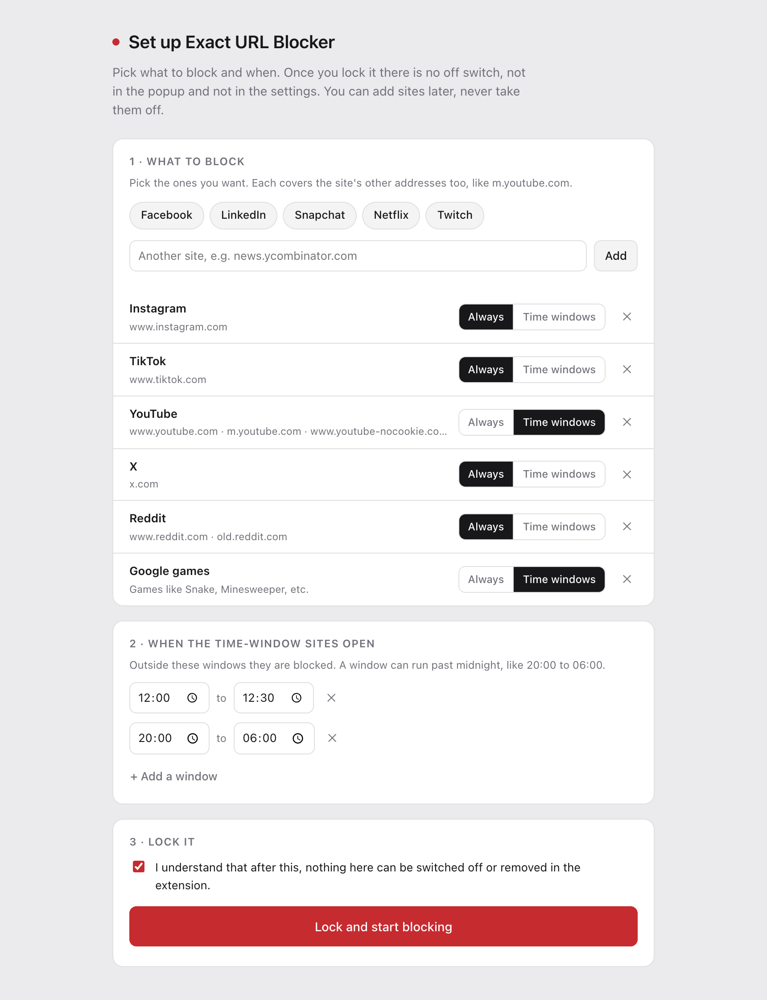
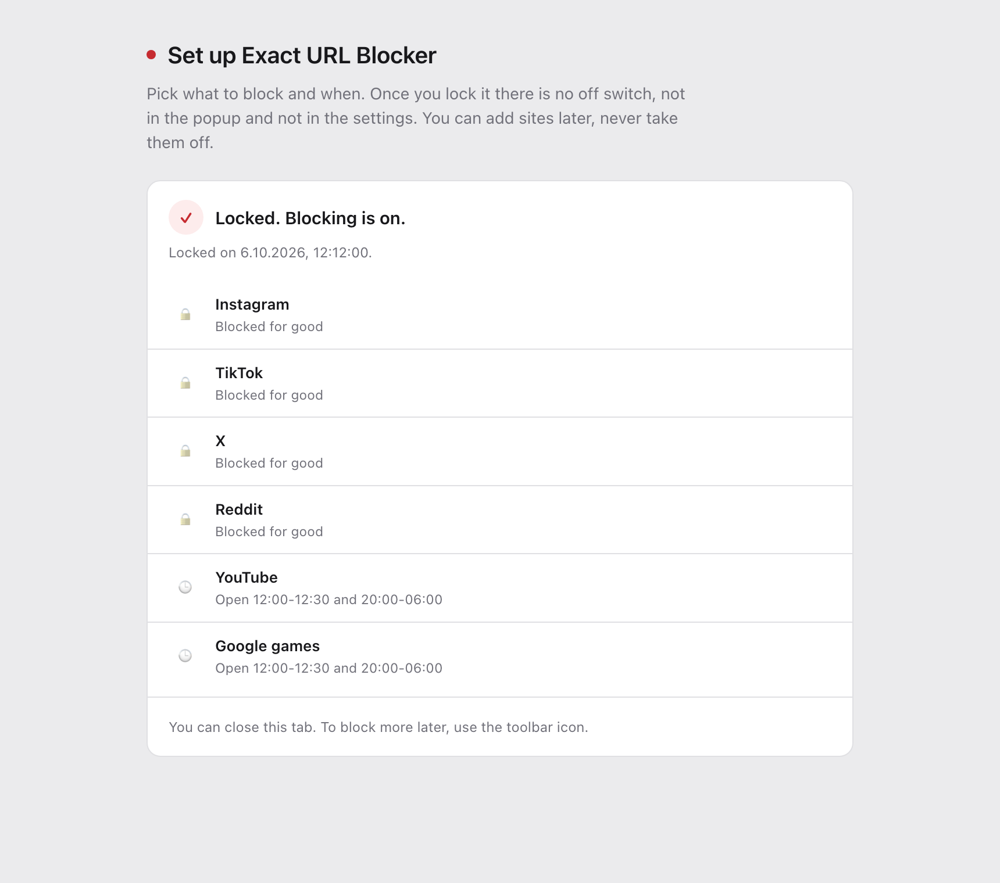
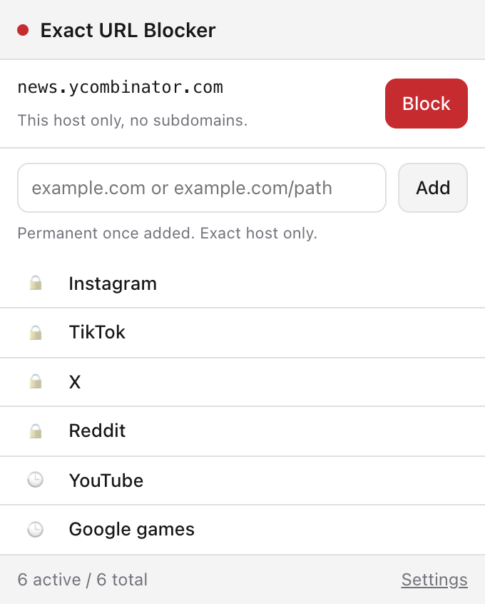
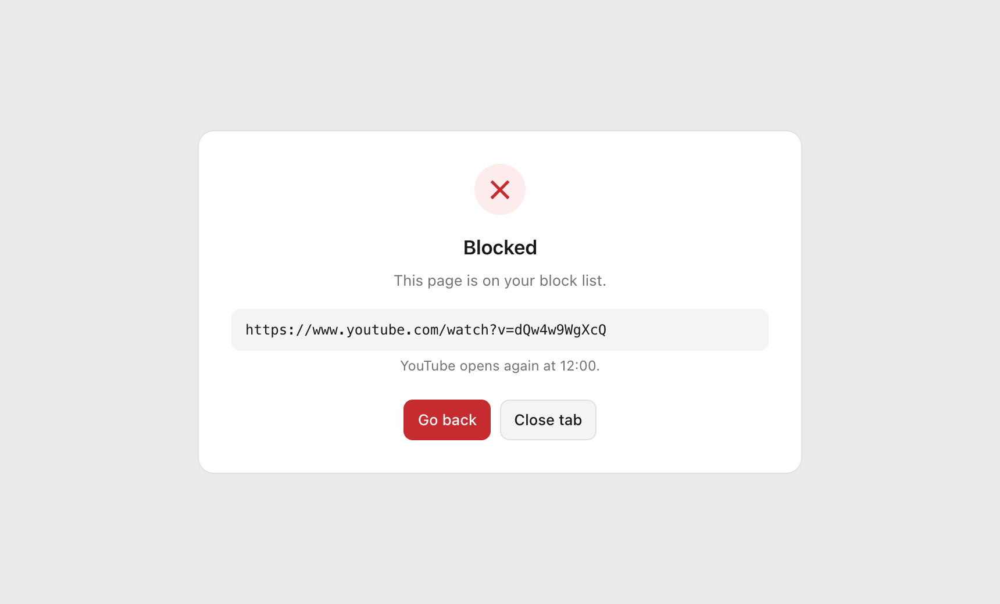

# Exact URL Blocker

A Chrome extension that blocks distracting sites for good. No off switch, no snooze, no "just this once". You decide once, during setup, and then it holds.

## What it does

- **No off switch.** After setup, the popup and the settings have no toggle, no delete and no "remove all". You can add sites, never take them off.
- **Time windows.** Some sites can open only at set times, say YouTube from 12:00 to 12:30 and from 20:00 to 06:00. Outside those windows they are blocked and there is no way to open them early. A video still playing when a window closes gets stopped.
- **Side doors closed.** Picking YouTube also blocks m.youtube.com and youtube-nocookie.com, Reddit includes old.reddit.com. Single-page apps can't route around a path rule either.
- **Google's games.** Snake, Minesweeper, Solitaire, PAC-MAN and the doodle games inside Google search can be blocked without touching search itself.
- **Exact matching.** `example.com` blocks example.com and www.example.com and nothing else. `reddit.com/r/all` blocks that section only.
- **Private.** Everything stays in your browser. No account, no server, no analytics.

## Install

The extension is not in the Chrome Web Store. You load it straight from this repository.

1. Get the code: **Code → Download ZIP** above and unzip it, or `git clone https://github.com/pm920/exact-url-blocker.git`.
2. Put the folder somewhere it can stay. Chrome reads the extension from that folder every time it starts. Moving or deleting it later removes the extension, and loading it from a new place starts over with an empty setup. Avoid folders that iCloud, OneDrive or Dropbox may offload: when the files are not on disk, the popup opens slowly or not at all.
3. Open `chrome://extensions`.
4. Switch on **Developer mode** (top right).
5. Click **Load unpacked** and pick the folder that contains `manifest.json`.
6. The setup page opens by itself. Pin the icon from the puzzle-piece menu if you want the popup one click away.

Built for Chrome. Other Chromium browsers (Edge, Brave, Arc) should work but are untested.

## Setup

1. **What to block.** Pick from the list or type your own address (`news.ycombinator.com`, `reddit.com/r/all`). For each one choose **Always** or **Time windows**.
2. **When the time-window sites open.** One or more windows. A window can run past midnight, like 20:00 to 06:00.
3. **Lock it.** Confirm, and blocking starts. From then on the setup page only shows what is locked.

## Using it

The popup blocks the site you are on with one click, or any address you type. Every addition is permanent. 🔒 marks what is blocked for good, 🕒 what runs on the time windows.

When you land on a blocked page you see where you were headed and, for a site on time windows, when it opens again.

  
  

## What it cannot stop

- **Turning the extension off or removing it** on `chrome://extensions`. No extension can prevent that. Removing it also wipes the setup.
- **Incognito windows.** Extensions are off there unless you allow them: `chrome://extensions` → Details → *Allow in Incognito*.
- **Other browsers.**

Closing those gaps takes a [Chrome policy](https://chromeenterprise.google/policies/), set through a configuration profile on macOS or the registry on Windows. `IncognitoModeAvailability` set to 1 turns incognito off, and `URLBlocklist` makes Chrome itself refuse a list of sites, whatever extensions are installed.

## Fixing a mistake

There is no delete button, on purpose. If you added a site by accident, open `src/policy.js`, add its host to `NEVER_BLOCK`, and click the reload icon of the extension on `chrome://extensions`. `google.com` is on that list from the start, since blocking it would take search, sign-in and every reCAPTCHA down with it. The Google games option is not affected.

To start over completely, remove the extension and load it again. That wipes everything, which is the point.

## Updating

Run `git pull`, or download the ZIP again into the same folder, then click the reload icon on `chrome://extensions`. Your setup and your list survive as long as the folder stays where it is.

## How matching works

| Entry | Blocked | Not blocked |
|---|---|---|
| `example.com` | `example.com`, `www.example.com`, any path on them | `mail.example.com`, `a.b.example.com`, `example.company` |
| `mail.example.com` | `mail.example.com` | `example.com`, `x.mail.example.com` |
| `reddit.com/r/all` | `/r/all`, `/r/all/top`, `/r/all?sort=new` | `/r/allergies`, `/r/popular`, `reddit.com/` |
| `localhost:3000` | port 3000 | port 5173 |

`www.` is the one prefix treated as the same site, because bare domains normally redirect there. No other subdomain is implied: add it as its own entry. Matching is case-insensitive, covers `http` and `https`, and applies to pages and frames.

Chrome's blocking API only sees real network requests. Apps like YouTube, X or Reddit change the address without one, so the extension also checks every in-app navigation and applies the same rules there.

## Permissions

| Permission | Why |
|---|---|
| `declarativeNetRequest` | Blocks a page before it loads and sends you to the block page. |
| Access to all sites | So any site you add can be blocked. Nothing is read or sent anywhere. |
| `webNavigation` | Catches in-app navigation (YouTube, X) and finds game frames on top of Google search. |
| `storage` | Keeps your list and setup, in this browser only. |
| `alarms` | Wakes the extension when a time window opens or closes. |

## Development

| Path | Role |
|---|---|
| `src/rules.js` | Parsing and pattern building. The whole matching contract lives here. |
| `src/policy.js` | What is blocked when: presets, `NEVER_BLOCK`, time windows, `enforce()`. |
| `src/background.js` | Turns the list into blocking rules, keeps them in sync, runs the time windows. |
| `src/store.js` | `chrome.storage.local` wrapper. |
| `setup.html` / `src/setup.js` | The one-time setup. |
| `popup.html` / `src/popup.js` | Block the current site, add more, see the list. |
| `options.html` / `src/options.js` | Bulk add, export and import. |
| `blocked.html` / `src/blocked.js` | The page you land on instead. |

Every page and the background read state through `enforce()` in `src/policy.js`, which is why nothing a page writes to storage can switch a block off. The popup checks the live rules against the list on every open and warns when they differ.

State lives in `chrome.storage.local`, not `sync`: sync caps one item at 8 KB, which a long list would hit and then fail to write without saying so.

`src/rules.js` and `src/policy.js` have no dependencies and run in Node:

    node --input-type=module -e "import('./src/rules.js').then(m => console.log(m.buildRegex(m.parseEntry('reddit.com/r/all'), true)))"

## License

[MIT](LICENSE)
